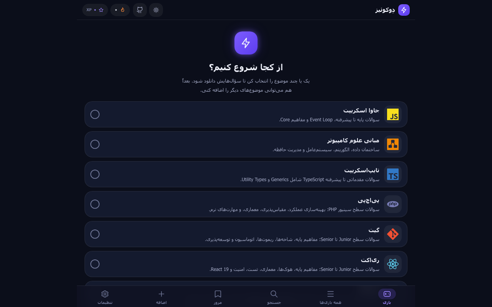

<div align="center" dir="rtl">

# سوالات مصاحبه React و Next.js به فارسی ⚡ دِوکوئیز (DevQuiz)

**بیش از ۱۷۰ سوال مصاحبه ری‌اکت (React)، ۱۵۰ سوال مصاحبه Next.js و ۱۴۰ سوال مصاحبه جاوا اسکریپت، با پاسخ کامل فارسی، رایگان و بازی‌وار**

ری‌اکت · Next.js · جاوا اسکریپت · تایپ‌اسکریپت · HTML · CSS · گیت · PHP · REST API · سئو

[](https://javadsharifi.github.io/devquiz/)

[](#-نصب-افزونه)
[](#-نصب-افزونه)
[](https://www.typescriptlang.org/)
[](https://javadsharifi.github.io/devquiz/)

<a href="https://javadsharifi.github.io/devquiz/">
  
</a>

</div>

<div dir="rtl">

## 📖 دِوکوئیز چیست؟

**دِوکوئیز** مجموعه **سوالات مصاحبه فنی برنامه‌نویسی به زبان فارسی** است؛ به‌ویژه **سوالات مصاحبه React (ری‌اکت / ریکت)** و **سوالات مصاحبه Next.js (نکست جی‌اس)**. هر سوال یک **پاسخ کامل و آموزشی** دارد و در قالب **فلش‌کارت** در یک وب‌اپ و افزونه مرورگر (کروم و فایرفاکس) ارائه می‌شود؛ مثل دولینگو، با **XP، استریک روزانه، نوار پیشرفت و جشن پایان مرحله**، تا مرور سوالات خسته‌کننده نباشد.

اگر دنبال **سوالات مصاحبه جاوا اسکریپت**، **سوالات مصاحبه ری‌اکت**، **سوالات مصاحبه Next.js** یا آماده‌شدن برای **مصاحبه شغلی فرانت‌اند** هستید، دِوکوئیز برای شماست.

👉 **[همین حالا شروع کنید: javadsharifi.github.io/devquiz](https://javadsharifi.github.io/devquiz/)**

بدون ثبت‌نام، بدون پرداخت، مستقیم در مرورگر.

## ✨ ویژگی‌ها

- 🃏 **فلش‌کارت سه‌بعدی**؛ سوال را بخوانید، کارت را برگردانید و جواب را ببینید
- 🎯 **سه سطح سختی**؛ از Junior تا Senior در هر موضوع
- 🔥 **استریک روزانه و XP**؛ انگیزه برای تمرین هر روز
- ✅ **بلدم / یاد می‌گیرم / رد کن**؛ سوالات بلد نیستی بیشتر تکرار می‌شوند
- 🔍 **جستجو** بین همه سوالات و **مرور** سوالاتی که هنوز یاد نگرفته‌اید
- ➕ **افزودن سوال شخصی** و پشتیبان‌گیری از پیشرفت
- 🌗 **تم روشن و تیره**، اندازه فونت قابل تنظیم
- ⌨️ **میان‌بر صفحه‌کلید** (Space برای برگرداندن کارت، فلش‌ها برای پاسخ)
- 🌐 **کاملاً راست‌به‌چپ (RTL)** با بلوک‌های کد چپ‌به‌راست و فونت وزیرمتن
- 📱 **ریسپانسیو**؛ روی موبایل و دسکتاپ، و **کار آفلاین** پس از دانلود موضوع

## ⚛️ سوالات مصاحبه React (ری‌اکت)

بیش از **۱۷۰ سوال مصاحبه ری‌اکت** از سطح Junior تا Senior، همراه با پاسخ کامل فارسی و مثال کد، در ۲۷ دسته:

مفاهیم پایه · Props و State · هوک‌ها (`useState`، `useEffect`، `useMemo`، `useCallback`، `useRef`، `useReducer`) · Context API · مدیریت State · بهینه‌سازی عملکرد و رندر مجدد · Routing · Error Boundaries و Portals · تایپ‌اسکریپت در React · تست‌نویسی با RTL · معماری Fiber · Concurrent React · Suspense و SSR و Hydration · **Server Components و Server Actions** · **React 19 و React Compiler**

نمونه سوالات:

- الگوهای مدیریت State در React را نام ببرید و مقایسه کنید (Local, Global, Server, URL).
- استراتژی‌های جلوگیری از رندر مجدد بی‌مورد چیست؟
- مفهوم «State as a Snapshot» چیست؟
- تفاوت Effect با Event در React چیست؟
- هزینه `useMemo` چیست و چه زمانی کمکی نمی‌کند؟
- Streaming SSR و Selective Hydration در React 18 چگونه کار می‌کنند؟
- Compound Components و Polymorphic Component چیست؟

👉 **[تمرین سوالات مصاحبه React](https://javadsharifi.github.io/devquiz/)**

## ▲ سوالات مصاحبه Next.js (نکست جی‌اس)

بیش از **۱۵۰ سوال مصاحبه Next.js** بر پایه **App Router** و نسخه‌های جدید، در ۳۰+ دسته:

Routing و Navigation · Server Components در برابر Client Components · `'use client'` · Data Fetching و Cache · رندرینگ (SSR، SSG، ISR، Streaming) · Server Actions · Middleware · Cookies و Headers · SEO و Metadata · تصاویر و فونت · احراز هویت · امنیت · بهینه‌سازی عملکرد · تست و دیباگ · استقرار (Deployment) · سناریوهای معماری واقعی

نمونه سوالات:

- تفاوت App Router و Pages Router در Next.js چیست؟
- Server Component چیست و چه تفاوتی با Client Component دارد؟
- چه زمانی باید از `'use client'` استفاده کنیم؟
- تفاوت ISR با SSG و SSR چیست؟
- چطور از Server Actions برای ارسال امن فرم استفاده کنیم؟
- فرایند Hydration و Partial Hydration در Next.js چیست؟
- معماری یک فروشگاه اینترنتی SEO-friendly با Next.js را چطور طراحی می‌کنید؟

👉 **[تمرین سوالات مصاحبه Next.js](https://javadsharifi.github.io/devquiz/)**

## 🟨 سوالات مصاحبه جاوا اسکریپت

بیش از **۱۴۰ سوال مصاحبه جاوا اسکریپت**: متغیرها و انواع داده، Closure، `this`، Prototype، Event Loop، Promise و `async/await`، ES6+، DOM، مدیریت حافظه و امنیت. مناسب هر مصاحبه فرانت‌اند و فول‌استک.

## 📚 همه موضوعات

| موضوع | سرفصل‌ها |
|---|---|
| **ری‌اکت (React)** · ۱۷۰+ سوال | هوک‌ها، معماری، تست، امنیت، React 19 |
| **Next.js** · ۱۵۰+ سوال | Routing، Data Fetching، Server Components، استقرار |
| **جاوا اسکریپت** · ۱۴۰+ سوال | مفاهیم پایه تا پیشرفته، Event Loop، Core |
| **تایپ‌اسکریپت (TypeScript)** | Generics، Utility Types |
| **HTML5** | تگ‌های معنایی، فرم‌ها، دسترسی‌پذیری، وب‌کامپوننت |
| **CSS3** | Flexbox، Grid، انیمیشن، متغیرها |
| **گیت (Git)** | شاخه‌ها، ریموت‌ها، اتوماسیون |
| **پی‌اچ‌پی (PHP)** | عملکرد، مقیاس‌پذیری، معماری |
| **REST API** | متدهای HTTP، کدهای وضعیت، احراز هویت |
| **سئو (SEO)** | رندرینگ SSR/CSR، Core Web Vitals |
| **مبانی علوم کامپیوتر** | ساختمان داده، الگوریتم، سیستم‌عامل |
| **DevTools وب** | Elements، Console، Network، Performance |
| **سیستم‌های طراحی** | دیزاین توکن، کامپوننت، مستندسازی |
| **ابزارهای UX** | پژوهش، پروتوتایپ، تست کاربردپذیری |

موضوعات جدید به‌صورت مداوم اضافه می‌شود.

## 🚀 شروع سریع

1. وارد **[javadsharifi.github.io/devquiz](https://javadsharifi.github.io/devquiz/)** شوید.
2. یک یا چند موضوع را انتخاب کنید تا سوالاتش دانلود شود.
3. روی «بازی» بزنید، سطح و دسته را انتخاب کنید و تمرین را شروع کنید.

## 🧩 نصب افزونه

| پلتفرم | ساخت | نصب |
|---|---|---|
| Chrome (MV3) | `pnpm run build:chrome` | `chrome://extensions` ← حالت Developer ← Load unpacked ← پوشه `dist/chrome/` |
| Firefox (MV3) | `pnpm run build:firefox` | `about:debugging` ← Load Temporary Add-on ← پوشه `dist/firefox/` |
| وب (GitHub Pages) | `pnpm run build:web` | با هر push روی `main` خودکار منتشر می‌شود |

## ❓ سوالات متداول

**بهترین منبع سوالات مصاحبه React به فارسی کجاست؟**
دِوکوئیز بیش از ۱۷۰ سوال مصاحبه ری‌اکت با پاسخ کامل فارسی دارد، از مفاهیم پایه و هوک‌ها تا Server Components و React 19، و می‌توانید همین حالا آنلاین تمرین کنید.

**سوالات مصاحبه Next.js شامل چه مباحثی است؟**
App Router، Server و Client Components، Data Fetching و Cache، SSR/SSG/ISR، Server Actions، Middleware، SEO، احراز هویت، امنیت و استقرار، به‌علاوه سوالات سناریو-محور معماری.

**سوالات برای مصاحبه سینیور هم مناسب است؟**
بله، هر موضوع از Junior تا Senior دسته‌بندی شده و شامل سوالات معماری و تصمیم‌گیری کلان است.

**دِوکوئیز رایگان است؟**
بله، کاملاً رایگان و متن‌باز است.

**برای مصاحبه چه سطحی مناسب است؟**
سوالات از Junior تا Senior دسته‌بندی شده‌اند؛ هم برای شروع کار و هم برای مصاحبه‌های سینیور.

**نیاز به ثبت‌نام دارد؟**
خیر. پیشرفت شما روی همین دستگاه ذخیره می‌شود و ورود به حساب اختیاری است.

**می‌توانم سوال خودم را اضافه کنم؟**
بله، از تب «اضافه» سوال شخصی بسازید؛ این سوالات هرگز با به‌روزرسانی موضوعات پاک نمی‌شوند.

## 🛠️ برای توسعه‌دهندگان

یک کدبیس TypeScript با سه خروجی (Chrome، Firefox، وب). معماری و الگوی platform-adapter در [`ARCHITECTURE.md`](./ARCHITECTURE.md) و نقشه پروژه در [`PROJECT_MAP.md`](./PROJECT_MAP.md) توضیح داده شده است.

```bash
pnpm install
pnpm run build        # هر سه هدف
pnpm run build:web    # فقط وب
pnpm run typecheck
pnpm test
```

</div>

```
src/app/        — راه‌اندازی، هدر، ناوبری، تم
src/features/   — بازی، جستجو، افزودن، تنظیمات
src/services/   — API، ذخیره‌سازی، همگام‌سازی
src/components/ — اجزای UI مشترک (کارت، toast، progress ...)
backend/        — Cloudflare Worker برای حساب کاربری و همگام‌سازی
```

<div dir="rtl">

قواعد مهم: اعتبارسنجی JSON دریافتی قبل از ذخیره، کلیدهای `user_states` همیشه به‌شکل `topicId:questionId`، و ادغام سوالات شخصی فقط در حافظه هنگام رندر. Markdown با یک sanitizer سخت‌گیرانه (بدون `innerHTML`) نمایش داده می‌شود.

## 🤝 مشارکت

Issue و Pull Request خوش‌آمد است؛ برای پیشنهاد سوال یا موضوع جدید یک Issue باز کنید. اگر دِوکوئیز به کارتان آمد، با ⭐ دادن به ریپو حمایت کنید.

## 📄 لایسنس

کد پروژه متن‌باز است. `marked` تحت MIT و فونت وزیرمتن تحت SIL OFL (© صابر راستی‌کردار).

---

**کلیدواژه‌ها:** سوالات مصاحبه React · سوالات مصاحبه ری‌اکت · سوالات مصاحبه ریکت · سوالات مصاحبه Next.js · سوالات مصاحبه نکست جی‌اس · سوالات مصاحبه جاوا اسکریپت · سوالات مصاحبه فرانت‌اند · سوالات مصاحبه برنامه‌نویسی · مصاحبه شغلی فرانت‌اند · آمادگی مصاحبه · فلش‌کارت برنامه‌نویسی · React interview questions in Persian · Next.js interview questions · DevQuiz

</div>
